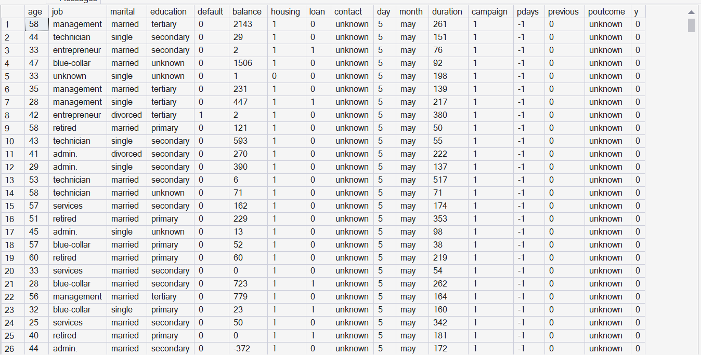

# Bank_Marketing_Analysis
- Market analysis of a Portuguese bank's marketing campaign data :does previous campaigns outcome affect term deposit prediction? Using  SQL, EXCEL and R.

- I do not own this dataset.

[Moro et al., 2011] S. Moro, R. Laureano and P. Cortez. Using Data Mining for Bank Direct Marketing: An Application of the CRISP-DM Methodology.

## Hypothesis
H0: Subscription  is independent of previous  campaign outcome.

H1: Subscription  is dependent of previous campaign outcome.

- Basically, we are testing the association between Subscription and previous campaign outcome.

# Data Cleaning
- Checked for null values, missing values and inconsistent values using SQL.

- No NULL values were found. I didn't find missing values'' but  I found 'unknown' values across job, education ,contact, and poutcome and decided to leave them there because it might alter our data.

- Since the data had no unique values or columns I didn't check for duplicates.

### Cleaned Bank Market file.

## Finding :Previous Campaign Outcome
|Previous Outcome | Subscription_Rate| Lift vs Overall|
|---|---|---|
|success|64.73|5.54x|
|failure|12.61|1.08x|
|other|16.68|1.43x|
|unknown|9.16|0.78x|

Overall subscription rate:11.69%

χ²(3)=4391.5, p-value<0.001, Cramer's V=0.31

- There is a statistically significant, moderate association between previous campaign outcome and subscription rate(χ²(3)=4391.5, p-value<0.001, Cramer's V=0.31) hence it is helpful to predict who is likely to subscribe and to find the target audience.
  
 # Finding: Logistic regression model in R
 Independence model: residual deviance=1644, df=3, p-value<0.001, AIC=1730
 Saturated model: AIC=j91.72
 Pearson chi-square= 4391.5, df=3, p-value<0.001
 -The independence model fits poorly, while the saturated model reproduces the data exactly and produces a much lower AIC which shows accuracy.

# A Bar Chart Subscription Rate by Previous Campaign Outcome 

**Takeaway:** Clients with a previous successful campaign outcome were 5.5 times more likely to subscribe to the term deposit.

**Conclusion:** Subscription is dependent of previous campaign outcomes. The analysis has shown clients with a successful previous campaign outcome are 5.5x more likely to subscribe.

**Limitation:** Association does not mean causation. We do not know whether the clients are subscribing to the term deposit because of previous campaign outcomes. That is not explained by this analysis. Additionally, the "unknown" group is large and the results might be affected  depending on how they were handled. We also have analyzed only two variables, that is why the saturated model was better.

